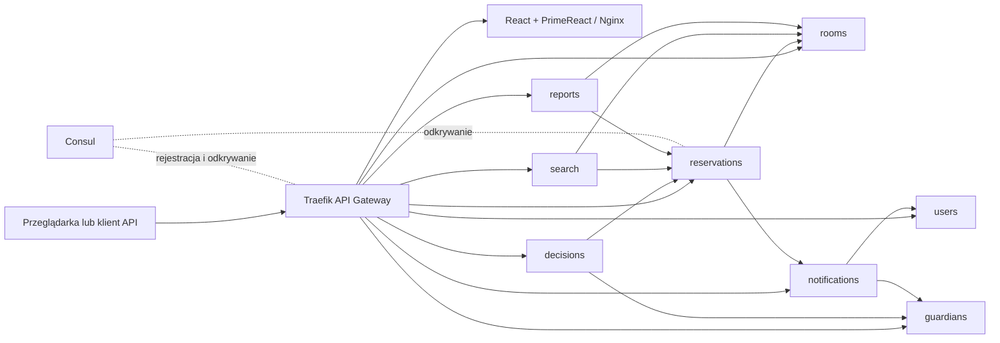

# Architektura systemu rezerwacji sal

## Cel i zakres

Projekt realizuje temat alternatywny dopuszczony na stronie 2 instrukcji `laboratory-2026Z.pdf`.
Zachowuje Django, PostgreSQL i Docker. Osiem usług biznesowych działa w oddzielnych procesach
i komunikuje się przez HTTP; osobny frontend React + PrimeReact jest interfejsem użytkownika.

| Usługa | Własne dane | Główne API |
|---|---|---|
| `users` | Konta, hasła, grupy | `/api/users/`, `/api/users/login/` |
| `rooms` | Sale i atrybuty | `/api/rooms/` |
| `guardians` | Przypisania opiekunów | `/api/guardians/` |
| `reservations` | Rezerwacje i trwała kolejka zdarzeń | `/api/reservations/` |
| `decisions` | Historia decyzji opiekunów | `/api/decisions/` |
| `notifications` | Historia wysyłek | `/api/notifications/` |
| `search` | Brak, agreguje dane sal i rezerwacji | `/api/search/` |
| `reports` | Brak, agreguje statystyki | `/api/reports/` |

Każda usługa z danymi ma własny schemat PostgreSQL. Wspólny serwer bazodanowy upraszcza
środowisko laboratoryjne, ale aplikacje nie używają wspólnych tabel ani kluczy obcych pomiędzy
schematami. `search` i `reports` są usługami bezstanowymi. Dane istniejącej aplikacji Django
pozostają w schemacie `public`; nowy układ nie kopiuje ich automatycznie.
Usunięcie konta przez API dezaktywuje je, aby zachować identyfikatory w historii rezerwacji.

## Ruch i odkrywanie usług

Przy starcie każda usługa rejestruje w Consul adres i kontrolę `/health/`.
Traefik odczytuje katalog Consul i automatycznie tworzy trasy `/api/<usługa>/`.
Wywołania wewnętrzne rozpoznają adres przez Consul i mają limit czasu 4 sekundy.
Katalog Consula jest zapisywany w wolumenie `consul_data`. Frontend ma osobną trasę
z pliku `frontend/gateway.yml`, z niższym priorytetem niż ścieżki API.

## Dostęp do interfejsu

Wyszukiwarka i `GET /api/reservations/calendar/?room_id=<id>` są publiczne.
Kalendarz zwraca jedynie `id`, `room_id`, `start`, `end`, `status` dla zajętych terminów
(`pending`, `approved`); nie udostępnia danych osobowych ani treści wniosków.
Opcjonalne parametry `start` i `end` przyjmują ISO 8601 ze strefą czasu i ograniczają
zakres widoku. Pracownik loguje się dopiero do złożenia wniosku.
`GET /api/guardians/mine/` wymaga tokenu i zwraca przypisania wyłącznie zalogowanego opiekuna.
Administracja i składanie wniosków zachowują kontrolę dostępu po stronie Django.
Administrator wydaje decyzję tylko jako przypisany opiekun. Odrzucenie wymaga komentarza.
Wniosek `pending` blokuje termin do decyzji lub anulowania; nie ma automatycznego wygaszania.
Raporty są dostępne w JSON i jako zestawienia w interfejsie; eksport CSV/PDF nie jest zaimplementowany.
Nieudana zależność zwraca `503` lub `502`, zamiast zawieszać żądanie bez końca.

## Scenariusz rezerwacji

1. Administrator zakłada konto w `users`, salę w `rooms` i przypisanie opiekuna w `guardians`.
2. Pracownik loguje się. `users` wydaje podpisany token ważny godzinę.
3. `reservations` sprawdza istnienie sali przez API `rooms`, godziny 07:00–22:00 i konflikty.
4. W transakcji PostgreSQL blokada doradcza dla `room_id` chroni przed równoczesnymi rezerwacjami.
5. Po zapisie rezerwacji powstaje trwałe zdarzenie. `notifications` odnajduje opiekunów i wysyła wiadomości.
6. `decisions` sprawdza uprawnienie opiekuna w `guardians`, a status zmienia właściciel danych: `reservations`.
7. Zdarzenia niewysłane odczytuje `reservation-worker` i ponawia co 10 sekund.
   Decyzje, których nie udało się zastosować, odczytuje `decision-worker`.

Zdarzenia e-mail mają identyfikator (`rodzaj:rezerwacja:odbiorca`), dzięki czemu ponowienie
nie wysyła drugi raz wiadomości zapisanej jako wysłana. Domyślnie wiadomości trafiają do logów
kontenera; do rzeczywistego SMTP trzeba ustawić zmienne `EMAIL_*`.

## Wymagania z instrukcji

| Strona PDF | Obowiązkowy temat | Realizacja |
|---|---|---|
| 14 | Mikroserwis i CRUD | `users`, `rooms` i pozostałe API Django |
| 25 | Trwałość danych | PostgreSQL; cache na tej stronie opisano jako opcjonalny |
| 36 | Odkrywanie usług | Consul, rejestracja i health checks |
| 45 | Brama API | Traefik z trasami z katalogu Consul |
| 54 | Komunikacja | REST między usługami, szczególnie powiadomienia |
| 66 | Konteneryzacja | Docker Compose, oddzielne kontenery usług |

Centralna konfiguracja, JWT, kolejka RabbitMQ i Kubernetes występują w przykładach lub
częściach dla ochotników, więc nie są wymagane do minimalnego zakresu. Podpisany token Django
zastępuje JWT bez zmiany stosu technologicznego.

## Decyzje i ograniczenia

Właścicielem statusu jest `reservations`, a `decisions` zapisuje decyzję przed próbą zmiany statusu.
Ponawianie jest bezpieczne, ponieważ ta sama decyzja daje ten sam wynik. Konflikt z późniejszą
zmianą statusu oznacza decyzję jako `blocked` do ręcznego wyjaśnienia.
Token przechowuje rolę przez godzinę; zmiana roli lub blokada
użytkownika nie unieważnia natychmiast wydanego tokenu. To rozwiązanie demonstracyjne;
przed publicznym wdrożeniem potrzebne są TLS, zewnętrzny magazyn sekretów i mocniejsza
kontrola wywołań wewnętrznych.

## Weryfikacja

`python scripts/smoke_microservices.py` przechodzi przez bramę i sprawdza osiem usług:
logowanie, utworzenie użytkownika i sali, przypisanie opiekuna, wyszukiwanie,
rezerwację, decyzję, powiadomienia i raport. Każda usługa ma też testy Django
uruchamiane z `SERVICE_NAME=<nazwa> python microservices/manage.py test microservices.<nazwa>`.
