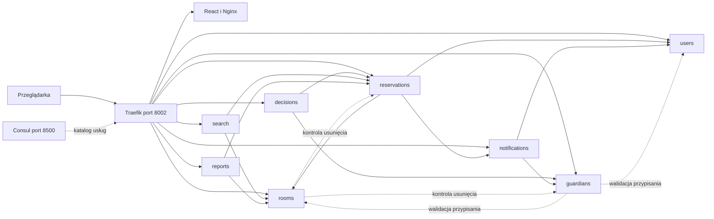
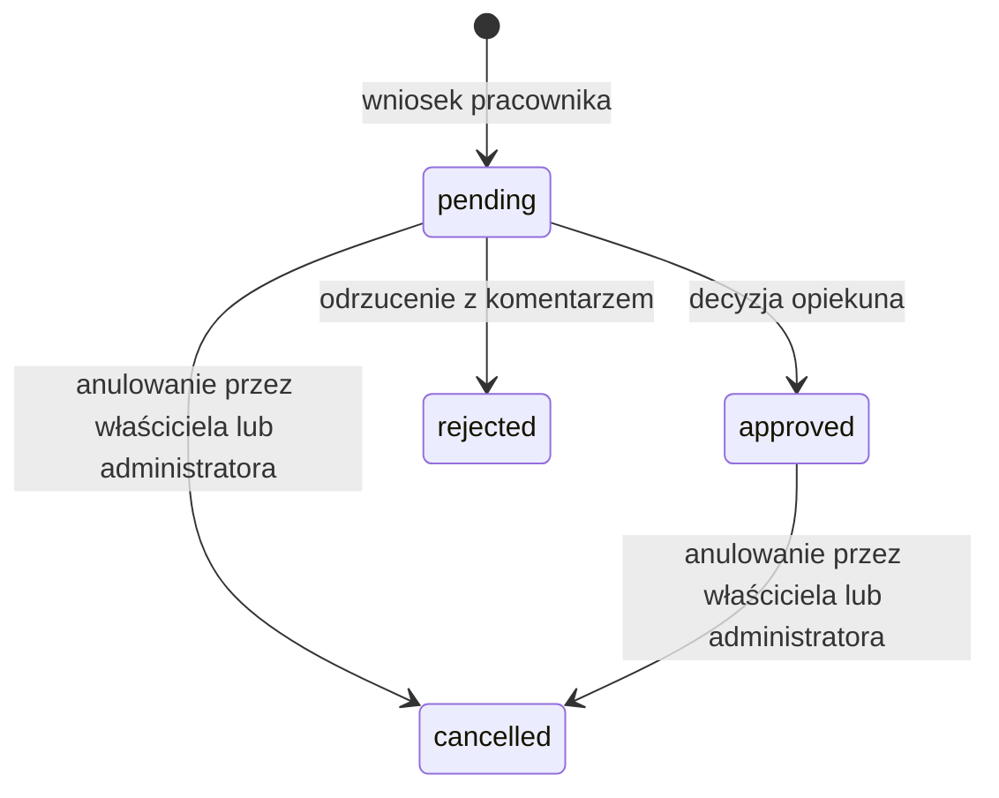
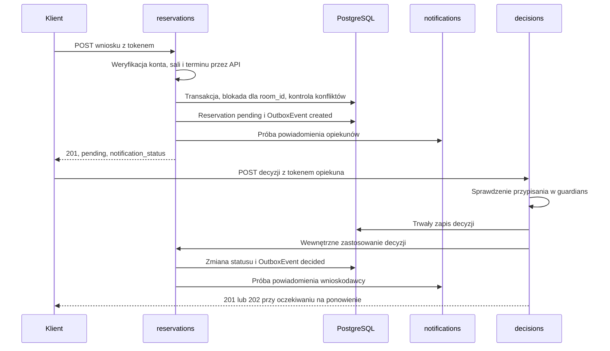

# Dokumentacja projektu systemu rezerwacji sal

Dokument opisuje działającą implementację aplikacji do wyszukiwania i rezerwowania sal
w architekturze mikroserwisowej. Jest przeznaczony dla zespołu projektowego,
osoby prowadzącej laboratorium oraz programistów rozwijających system.
Stan dokumentacji: **15 listopada 2026**, kod bazowy: `7ef6152`.

## 1 Cel i zakres projektu

System udostępnia katalog sal, ich wyposażenie i kalendarz zajętości. Pracownik
składa wniosek o rezerwację, a przypisany opiekun zatwierdza go lub odrzuca.
Administrator zarządza kontami, salami i przypisaniami oraz przegląda raporty.
Student korzysta z wyszukiwarki i publicznego kalendarza bez zakładania konta.

Implementacja obejmuje osiem usług biznesowych Django oraz osobny frontend React.
PostgreSQL zapewnia trwałość danych, Consul odkrywanie usług, a Traefik wspólne wejście
do interfejsu i API. Środowisko jest przeznaczone do lokalnej demonstracji i nauki.

Publiczny kalendarz pokazuje zajęte przedziały czasu. Nie ujawnia treści wniosków,
danych wnioskodawcy ani komentarzy opiekuna. Wyszukiwarka bez filtra czasu zwraca
katalog sal spełniających kryteria; sama obecność sali na liście nie oznacza wolnego terminu.

## 2 Wymagania funkcjonalne

| Obszar | Zaimplementowane zachowanie |
|---|---|
| Katalog | Lista sal, budynek, pojemność, opis i wyposażenie |
| Wyszukiwanie | Filtry nazwy, budynku, minimalnej i maksymalnej liczby miejsc oraz wyposażenia |
| Wyposażenie | Kilka wybranych atrybutów oznacza wymaganie wszystkich z nich |
| Kalendarz | Publiczny widok miesiąca, tygodnia i dnia, czas Europe/Warsaw |
| Logowanie | Konta zakłada administrator; logowanie wydaje podpisany token |
| Rezerwacja | Wniosek pracownika, kontrola konfliktów i godzin 07:00–22:00 |
| Decyzja | Zatwierdzenie lub odrzucenie przez opiekuna danej sali |
| Anulowanie | Właściciel wniosku lub administrator anuluje rezerwację pending albo approved |
| Powiadomienia | Wiadomość do opiekunów po utworzeniu i do wnioskodawcy po decyzji |
| Administracja | Konta, sale, atrybuty wyposażenia i przypisania opiekunów |
| Raportowanie | Liczba sal, rezerwacji, rozkład statusów i zatwierdzone rezerwacje według sal; raport procentowej zajętości sal w wybranym okresie dla opiekunów i administratora z eksportem CSV |

Nie zaimplementowano samodzielnej rejestracji, eksportu raportów do PDF,
automatycznego wygaszania wniosków ani edycji terminu istniejącej rezerwacji.
Zmiana terminu wymaga anulowania i złożenia nowego wniosku.

## 3 Role i uprawnienia

| Typ dostępu | Logowanie | Uprawnienia |
|---|---|---|
| Student lub gość | Nie jest wymagane | Wyszukiwarka, szczegóły sal i publiczny kalendarz |
| Pracownik | Tak | Wnioski, lista własnych rezerwacji w interfejsie i anulowanie własnych wniosków |
| Opiekun | Tak | Dodatkowo panel i decyzje dotyczące przypisanych sal |
| Administrator | Tak | Zarządzanie systemem, raporty, historia powiadomień i anulowanie rezerwacji |

W bazie nie istnieje osobna grupa `Employees`. Pracownik jest aktywnym kontem bez
uprawnień administratora (`is_staff=False`) i bez grupy `Students`. Administrator
jest rozpoznawany przez `is_staff`, które API udostępnia jako `is_admin`.
Frontend przedstawia te kombinacje jako wybór typu konta.

Opiekun jest przypisaniem `user_id` do `room_id` w usłudze `guardians`, a nie globalną
rolą konta. Administrator może rozpatrywać wnioski tylko wtedy, gdy również został
przypisany jako opiekun danej sali. Konto w grupie `Students` nie może tworzyć rezerwacji.

**Zakres ochrony danych:** publiczny kalendarz jest ograniczony po stronie API.
Natomiast chronione tokenem `GET /api/reservations/` i odczyt pojedynczej rezerwacji
obecnie udostępniają dane rezerwacji każdemu zalogowanemu kontu. Widok „Moje rezerwacje”
filtruje dane po stronie React. Ograniczenie prywatnego odczytu po stronie backendu
pozostaje zadaniem przed wdrożeniem z rzeczywistymi danymi.

## 4 Technologie i struktura kodu

| Element | Wersja lub konfiguracja w projekcie |
|---|---|
| Backend | Python 3.11 w Dockerze, Django 5.2.12 |
| Baza | PostgreSQL 15, sterownik psycopg2-binary 2.9.9 |
| Frontend | React 18.3.1, PrimeReact 10.9.7, PrimeIcons 7.0.0 |
| Kalendarz | FullCalendar 6.1.19, integracja Luxon 3 |
| Routing frontendu | React Router DOM 7.18.5 |
| Budowanie frontendu | Vite 7, Node.js 22.12 lub nowszy; Docker używa node:22-alpine |
| Serwowanie frontendu | Nginx 1.28-alpine |
| Rejestr i brama | Consul 1.20, Traefik 3.1 |
| Testy | Django TestCase i Playwright 1.56.1 |

Wersje pakietów Pythona są w [requirements.txt](../requirements.txt), a JavaScript
w [package.json](../frontend/package.json) i [package-lock.json](../frontend/package-lock.json).
Nowe endpointy używają widoków Django i `JsonResponse`; DRF oraz django-filter pozostają
w zależnościach projektu, lecz nie stanowią warstwy nowych API.

```text
microservices/
  common.py          autoryzacja, JSON, Consul i wywołania HTTP
  settings.py        konfiguracja pojedynczej usługi i schematu
  bootstrap.py       utworzenie schematu PostgreSQL
  register.py        rejestracja w Consul
  start.sh           schemat, migracje, konta początkowe, rejestracja, serwer
  users/ rooms/ guardians/ reservations/
  decisions/ notifications/ search/ reports/
  portal/            opcjonalny starszy portal techniczny
frontend/
  src/               widoki i klient API React
  tests/             testy przeglądarkowe z atrapami API
  gateway.yml        trasa Traefika do frontendu
scripts/
  smoke_microservices.py   test przejścia przez osiem usług
docs/                dokumentacja i prezentacja
```

Katalogi `config`, `room_reservations`, `security`, `templates` i `static` zawierają
również wcześniejszą aplikację jednoprocesową. Nowy frontend wykorzystuje jej identyfikację
wizualną. Dane i endpointy monolitu są odrębne od mikroserwisów.

## 5 Architektura usług

| Usługa | Odpowiedzialność | Własne dane | Zależności HTTP |
|---|---|---|---|
| users | Uwierzytelnianie i konta | Użytkownicy, grupy Django | Brak biznesowych |
| rooms | Katalog sal | Room, Attribute, relacja wyposażenia | reservations i guardians przy usuwaniu sali |
| guardians | Przypisania opiekunów | Assignment | users, rooms przy tworzeniu przypisania |
| reservations | Terminy i statusy | Reservation, OutboxEvent | users, rooms, notifications |
| decisions | Decyzje i ponawianie ich zastosowania | Decision | reservations, guardians |
| notifications | Wysyłka i historia wiadomości | Notification | guardians, users |
| search | Złożone wyszukiwanie | Bez własnych danych biznesowych | rooms, reservations |
| reports | Statystyki | Bez własnych danych biznesowych | rooms, reservations |

`reservation-worker` i `decision-worker` są procesami pomocniczymi istniejących usług.
Frontend, baza, Consul i Traefik również nie powiększają liczby ośmiu usług biznesowych.



Traefik kieruje `/api/<nazwa>/` do usług zarejestrowanych w Consul. Wszystkie pozostałe
ścieżki obsługuje Nginx frontendu; jego reguła ma niższy priorytet. React wysyła żądania
do tego samego adresu `/api/`, bez znajomości adresów kontenerów i bez klucza usługowego.

Każdy kontener Django uruchamia osobny proces, który ładuje aplikację określoną przez
`SERVICE_NAME`. Kontenery używają wspólnego obrazu `room-reservation-service:local`.
Z tego powodu zmiana wspólnego obrazu wymaga odtworzenia zainteresowanych kontenerów.

## 6 Dane i granice odpowiedzialności

Istnieje jedna instancja PostgreSQL i jedna baza `DB_NAME`. Każdy proces ustawia
`search_path` na schemat odpowiadający nazwie usługi. Migracje i tabele są rozdzielone
schematami. `search` i `reports` nie utrwalają własnych danych biznesowych.

| Encja | Kluczowe pola i ograniczenia |
|---|---|
| Konto | Model auth.User Django, unikatowy username, hasło przechowywane jako hash |
| Room | Unikatowa name, building, capacity, description i wiele Attribute |
| Attribute | Unikatowa name; migracja dodaje początkowe wyposażenie |
| Assignment | user_id, room_id; unikatowa para |
| Reservation | room_id, user_id, title, start, end, status, note, decision_comment, created_at |
| OutboxEvent | Unikatowy event_id, kind, data, delivered, attempts, last_error |
| Decision | Unikatowy reservation_id, guardian_id, status, comment, applied, blocked, last_error |
| Notification | Unikatowy event_id, recipient, subject, body, state, error, created_at |

Identyfikatory innych usług są zwykłymi liczbami, bez kluczy obcych między schematami.
Istnienie konta i sali jest sprawdzane przez API. Usunięcie użytkownika dezaktywuje konto.
Usunięcie sali jest blokowane, jeśli ma jakiekolwiek rezerwacje lub przypisanych opiekunów.

Usługi korzystają z tego samego konta bazy. Oddzielne schematy organizują własność danych,
lecz nie zapewniają izolacji uprawnień takiej jak osobne role PostgreSQL lub bazy.
Monolit zachowuje dane w `public`; automatyczna migracja do usług nie została dodana.

## 7 Cykl rezerwacji i odporność



Wniosek musi mieć tytuł, salę i daty ISO 8601 ze strefą czasu. Koniec musi być późniejszy
od początku, oba terminy muszą przypadać w jednym dniu w Warszawie i mieścić się
w godzinach 07:00–22:00. Backend nie wymusza obecnie terminu w przyszłości.

`pending` i `approved` blokują przedział. Konflikt zachodzi, gdy istniejąca rezerwacja
zaczyna się przed końcem nowej i kończy po jej początku. Rezerwacje stykające się końcem
i początkiem są dozwolone. `rejected` i `cancelled` nie blokują dostępności.
Wniosek nie ma limitu czasu oczekiwania i nie wygasa automatycznie.



PostgreSQL używa `pg_advisory_xact_lock(room_id)` przy tworzeniu rezerwacji, aby
serializować równoległe wnioski dla tej samej sali. Zmiana decyzji i anulowanie blokują
rekord przez `select_for_update`. Testy na SQLite nie dowodzą działania blokad PostgreSQL.

Wniosek oraz zdarzenie powiadomienia zapisują się w jednej transakcji. Awaria wysyłki
nie usuwa wniosku: `notification_status=pending_retry`, a `reservation-worker` ponawia
niedostarczone zdarzenia. Procesy pomocnicze przeglądają do 50 rekordów w iteracji,
następnie czekają 10 sekund; rzeczywisty odstęp zależy również od czasu wywołań.

`decisions` najpierw zapisuje decyzję, a potem próbuje zastosować ją w `reservations`.
Przy niepowodzeniu zwraca `202` i `pending_retry`. `decision-worker` ponawia rekordy
`applied=False, blocked=False`. Konflikt `409` oznacza rekord jako `blocked` i wymaga
wyjaśnienia; nie ma dedykowanego panelu naprawczego. Ponowienie tej samej zastosowanej
decyzji w wewnętrznym API rezerwacji jest idempotentne.

Wysyłka wiadomości używa klucza `kind:reservation_id:user_id` i blokady rekordu.
Zapisany stan `sent` chroni przed zwykłym powtórzeniem. Awaria po przyjęciu wiadomości
przez SMTP, lecz przed zatwierdzeniem transakcji, nadal może spowodować duplikat.
Nie jest to gwarancja dostarczenia dokładnie raz.

Brak opiekuna lub adresu e-mail może dać `sent=0`, mimo poprawnego wykonania obsługi
zdarzenia. `notification_status=sent` oznacza zakończenie wywołania, a nie dowód
otrzymania wiadomości przez człowieka. Domyślny backend poczty zapisuje ją w logach.

## 8 Odkrywanie usług i uwierzytelnianie

[register.py](../microservices/register.py) rejestruje usługę przez HTTP API Consula,
używając standardowej biblioteki Python `urllib.request`. Wpis zawiera nazwę, adres,
port 8000, tagi routingu Traefika i kontrolę `/health/` co 5 sekund z timeoutem 2 sekundy.
Rejestracja ma do 30 prób przy starcie. Katalog pozostaje w wolumenie `consul_data`.

[common.py](../microservices/common.py) pobiera zdrowe instancje przez
`/v1/health/service/<nazwa>?passing=true`, z timeoutem 2 sekundy, i wybiera pierwszą.
Następnie wykonuje żądanie z timeoutem 4 sekundy. Nie ma wyboru losowego, circuit breakera
ani cache adresów. Błąd discovery daje zwykle `503`; błąd 5xx zależności jest mapowany
na `502`. Timeouty dotyczą poszczególnych operacji, nie całego łańcucha żądań.

Logowanie wydaje token podpisany mechanizmem Django signing, ważny 3600 sekund.
Nie jest to JWT. Klient przechowuje go w `sessionStorage` i przesyła nagłówek Bearer.
Wylogowanie usuwa token z klienta; nie ma rejestru unieważnionych tokenów.
`/users/me/` odczytuje zapisane claims, a nie aktualizuje rolę z bazy.

Wywołania wewnętrzne korzystają z `X-Service-Key`. Frontend nie ma tego klucza.
Obecne reguły Traefika obejmują również ścieżki `internal`; ich ochroną jest klucz,
a nie oddzielny publiczny i prywatny listener. Konfiguracja lokalna nie włącza TLS,
ACL Consula, limitów logowania ani zewnętrznego magazynu sekretów.

`/health/` potwierdza odpowiedź procesu HTTP. Nie sprawdza bazy, SMTP ani całego zestawu
zależności. Status `healthy` należy uzupełniać logami i testem funkcjonalnym.

## 9 Testy i potwierdzone wyniki

15 listopada 2026 ponownie wykonano testy wszystkich ośmiu usług na SQLite w pamięci:

| Usługa | Liczba testów | Wynik |
|---|---:|---|
| users | 5 | OK |
| rooms | 3 | OK |
| guardians | 2 | OK |
| reservations | 5 | OK |
| decisions | 2 | OK |
| notifications | 2 | OK |
| search | 1 | OK |
| reports | 1 | OK |
| Łącznie | 21 | OK |

Testy obejmują m.in. logowanie, tworzenie kont, idempotentne konto początkowe pracownika,
uprawnienia, izolację własnych przypisań, konflikty rezerwacji, publiczny kalendarz
bez danych prywatnych, decyzje, ponawianie powiadomień, wyszukiwanie i raport.

W poprzedniej weryfikacji przeszło 7 testów Playwright w Chrome z atrapami API:
publiczny odczyt, logowanie i wysłanie wniosku, wyposażenie, zaznaczanie czasu,
odmowa administracji pracownikowi, blokada składania wniosków przez studenta
oraz anulowanie logowania. Nie zastępują one integracyjnego testu prawdziwego API.

Wcześniejszy test `scripts/smoke_microservices.py` przeszedł przez Traefik, Consul,
PostgreSQL i osiem usług. Potwierdzono również logowanie rzeczywistego pracownika,
złożenie i anulowanie jego wniosku oraz odmowę dostępu do administracji.
Nie przeprowadzono testów obciążenia, równoległych transakcji PostgreSQL ani
pełnego dostarczenia SMTP. Komendy i scenariusz odbioru są w [instrukcji utrzymania](utrzymanie.md).

## 10 Odniesienie do instrukcji laboratorium

Źródło wymagań: przekazany przez użytkownika plik `laboratory-2026Z.pdf`, dokument
„Microservices-based web application development”, 88 stron. Numery poniżej oznaczają
strony PDF. Strona 2 dopuszcza inny temat, a strona 4 inny stos technologiczny.

| Wymaganie | Strony | Realizacja w projekcie |
|---|---|---|
| Basic Microservice Creation | 7, 14 | Osobne procesy Django; CRUD użytkowników i sal |
| Data Persistence and Caching | 7, 25 | PostgreSQL i trwały wolumen; cache nie dodano, na str. 25 jest opcjonalny |
| Service Discovery Integration | 7, 36 | Consul, rejestracja, health checks i odczyt zdrowych instancji |
| API Gateway Setup | 7, 45 | Traefik jako wejście HTTP do API i frontendu |
| Inter-Service Communication | 7, 54 | REST i usługa notifications; instrukcja dopuszcza REST lub messaging |
| Containerize Microservices | 7, 66 | Osobne kontenery, obrazy i Docker Compose |
| Raport architektury, przepływów i decyzji | 5 | Ten dokument oraz referencja API i instrukcje |
| Kod i konfiguracja | 5 | Katalogi usług, frontend, Compose i przykład środowiska |
| Skrypty testowe | 5 | Testy Django, Playwright i smoke_microservices.py |
| Prezentacja funkcjonalności | 5 | presentation.md i prezentacja.html; końcowe demo wymaga przygotowania |

Autoryzacja i odporność są dodatkowymi elementami. Kubernetes, RabbitMQ,
distributed tracing i centralny serwer konfiguracji nie zostały wdrożone.
Tabela przedstawia realizację tematów w kodzie, nie zastępuje oceny prowadzącego.

## 11 Ograniczenia i dalszy rozwój

Najważniejsze zadania przed wykorzystaniem z rzeczywistymi danymi to ograniczenie
prywatnego odczytu rezerwacji w backendzie, walidacja typów i długości danych wejściowych,
unieważnianie tokenów po zmianie roli oraz TLS i rozdzielenie uprawnień infrastruktury.

Implementacja nie skaluje automatycznie instancji. Identyfikator wpisu Consula jest
równy nazwie usługi, więc kolejne repliki nadpisywałyby tę samą rejestrację. Zwiększenie
liczby replik wymaga unikatowych identyfikatorów i strategii wyboru instancji.
Wspólna baza, Consul i brama są pojedynczymi punktami awarii lokalnej demonstracji.

Brakuje automatycznej migracji danych monolitu, paginacji list API i panelu naprawy
zablokowanych decyzji. Obecny kod zawiera również powtórzoną definicję i trasę
publicznego kalendarza; jest to zadanie porządkowe, które nie dodaje drugiego API.
Dokumentowanie projektu nie zmieniało tych zachowań aplikacji.

Szczegóły obsługi: [instrukcja użytkownika](uzytkownik.md).
Adresy i kontrakty: [API](api.md). Uruchomienie i administracja: [utrzymanie](utrzymanie.md).
